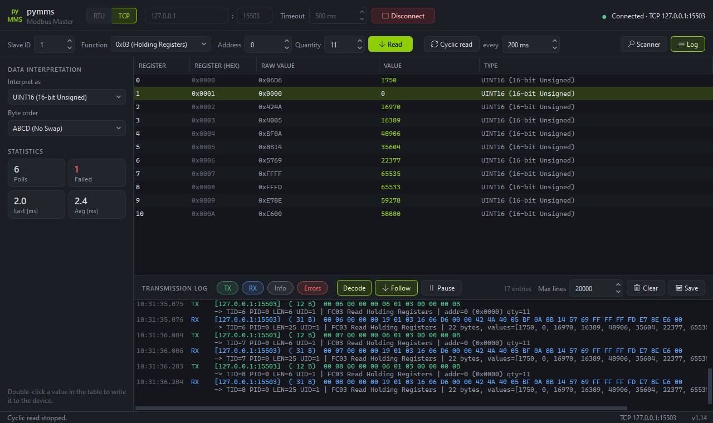
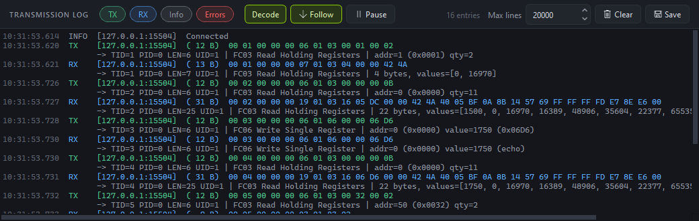
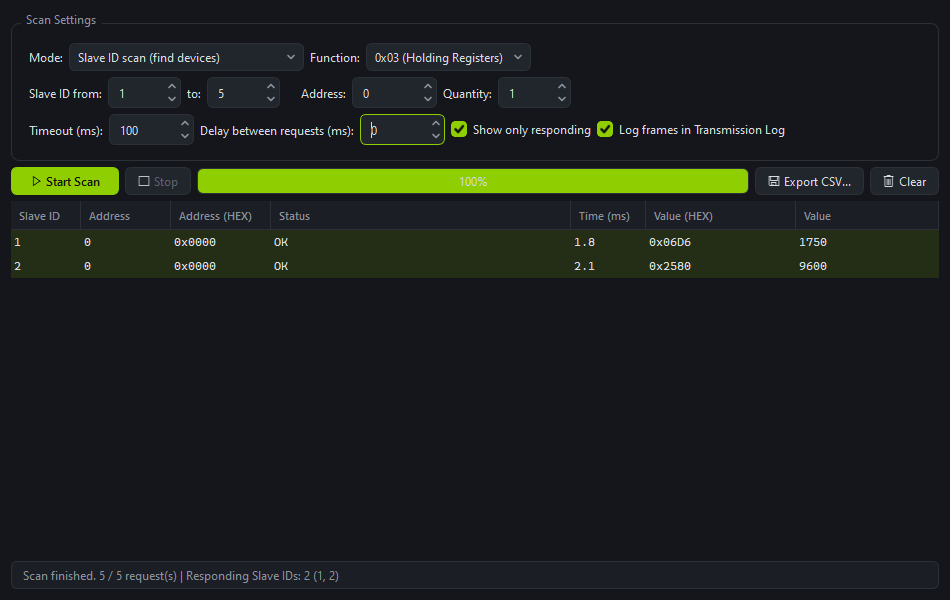
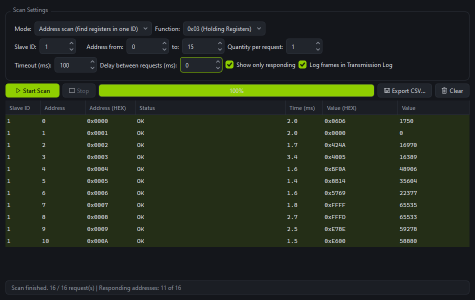

# pymms – Python Modbus Master Simulator

Prosty **Modbus master** z interfejsem graficznym (PyQt6). Służy do odczytu i zapisu rejestrów urządzeń Modbus
przez **RTU** (port COM) lub **TCP/IP**, z interpretacją danych jako liczby 16-, 32- i 64-bitowe oraz cyklicznym
odpytywaniem.

Narzędzie siostrzane: [pymss](https://github.com/exoper7/pymss) – symulator Modbus **slave**. Pozwala przetestować
pymms bez fizycznego urządzenia.



## Funkcje

- Połączenie **Modbus RTU** (port COM) lub **Modbus TCP**, z konfigurowalnym timeoutem.
- Odczyt: **0x01** Coils, **0x02** Discrete Inputs, **0x03** Holding Registers, **0x04** Input Registers.
- Interpretacja rejestrów jako UINT16, INT16, UINT32, INT32, FLOAT32, UINT64, INT64, FLOAT64,
  z kolejnością bajtów ABCD / CDAB / BADC / DCBA.
- **Zapis** wartości dwuklikiem w tabeli: 0x05 dla coili, 0x06 dla rejestrów 16-bitowych, 0x10 dla 32- i 64-bitowych.
- **Cykliczny odczyt** z ustawianym interwałem.
- **Okno logów transmisji** – każda wysłana i odebrana ramka w HEX z dekodowaniem, a także timeouty, błędy CRC,
  niepełne i spóźnione odpowiedzi.
- **Skaner** – wyszukiwanie urządzeń w zakresie Slave ID albo rejestrów w zakresie adresów, z eksportem wyników
  do pliku CSV gotowego do wczytania w pymss.
- Statystyki: liczba odpytań, liczba błędów, czas ostatniej odpowiedzi i średni czas odpowiedzi.
- Ciemny interfejs z zielonym kolorem wiodącym. Program zapamiętuje ustawienia połączenia i zapytania oraz układ okna.
- Własna implementacja Modbus master (TCP i RTU) – nie wymaga biblioteki pymodbus.

## Wymagania i uruchomienie

- Python 3.10+
- Biblioteki: `PyQt6`, `pyserial`

```bash
pip install PyQt6 pyserial
```

```bash
pythonw pymms.pyw
```

Budowa pliku exe (PyInstaller, ikona jest dołączana automatycznie):

```bash
pyinstaller pymms.spec
```

## Instrukcja obsługi

Okno składa się z czterech części:
- **górny pasek** – połączenie,
- **drugi pasek** – parametry zapytania,
- **panel boczny** – interpretacja danych i statystyki,
- **obszar główny** – tabela wyników, a pod nią log transmisji.

Ustawienia i układ okna są zapamiętywane między uruchomieniami w pliku **`pymms.ini` obok programu**
(obok `pymms.pyw` albo `pymms.exe`). Plik jest tekstowy i można go skopiować razem z programem albo usunąć,
żeby wrócić do ustawień domyślnych. Jeśli katalog programu jest tylko do odczytu (np. `Program Files`),
plik trafia do katalogu konfiguracji użytkownika: `%LOCALAPPDATA%\pymms` w Windows albo `~/.config/pymms`
w Linuksie.

### 1. Połączenie (górny pasek)

| Element | Opis |
|---|---|
| **RTU / TCP** | Rodzaj połączenia: Modbus RTU przez port szeregowy albo Modbus TCP/IP |
| Lista portów, **↻** | Port COM z opisem urządzenia (np. `COM3 · USB-SERIAL CH340`); przycisk odświeża listę |
| Prędkość, bity danych, parzystość, bity stopu | Parametry portu szeregowego (RTU), np. `9600`, `8`, `N`, `1` |
| Adres `:` port | Adres IP lub nazwa hosta i port urządzenia (TCP), domyślnie port 502 |
| **Timeout** | Czas oczekiwania na odpowiedź (100–30000 ms) |

Przycisk **Connect** nawiązuje połączenie i zmienia się w czerwony przycisk **Disconnect**. Ten zamyka połączenie
i zeruje statystyki. W trakcie połączenia parametrów połączenia nie można zmieniać. Stan połączenia widać po
prawej stronie paska: zielona kropka i adres urządzenia.

### 2. Odczyt danych (drugi pasek)

1. Ustaw **Slave ID**, **Address** i **Quantity**.
2. Wybierz funkcję (**Function**): `0x03 (Holding Registers)`, `0x04 (Input Registers)`, `0x01 (Coils)` lub
   `0x02 (Discrete Inputs)`.
3. Kliknij **Read**.

Maksymalna ilość to 125 rejestrów albo 2000 bitów. Dla typów 32-bitowych minimum to 2 rejestry, a dla
64-bitowych 4 rejestry.

### 3. Interpretacja danych (panel boczny)

- **Interpret as** – typ danych, na który składane są kolejne rejestry. Typy 32-bitowe zajmują 2 rejestry,
  64-bitowe 4 rejestry, a każdy wiersz tabeli pokazuje jedną wartość.
- **Byte order** – kolejność bajtów dla typów wielorejestrowych (patrz tabela niżej).

Kolumna **RAW VALUE** pokazuje surowe rejestry w HEX, a kolumna **VALUE** (wyróżniona na zielono) wartość
po interpretacji.


### 4. Zapis wartości

Kliknij dwukrotnie komórkę w kolumnie **VALUE**, wpisz nową wartość i zatwierdź **OK**. Zakres jest sprawdzany
dla wybranego typu. Po udanym zapisie pymms automatycznie odczytuje dane ponownie. Cykliczny odczyt jest
zatrzymywany przed zapisem.


| Dane | Funkcja zapisu |
|---|---|
| Coils (Boolean) | 0x05 Write Single Coil |
| UINT16 / INT16 | 0x06 Write Single Register |
| typy 32- i 64-bitowe | 0x10 Write Multiple Registers |

Discrete Inputs i Input Registers są w Modbus tylko do odczytu, więc urządzenie odrzuci zapis do nich.

### 5. Cykliczny odczyt

Ustaw interwał w polu **every** i włącz przełącznik **Cyclic read**. Odczyt powtarza się z bieżącymi parametrami,
aż ponownie klikniesz przełącznik. Odczyt zatrzymuje się też sam po utracie połączenia lub przekroczeniu czasu
odpowiedzi.

Kafelki **STATISTICS** w panelu bocznym pokazują liczbę odpytań (**Polls**), liczbę nieudanych odpytań (**Failed**,
na czerwono, gdy są błędy) oraz czas ostatniej (**Last**) i średni czas odpowiedzi (**Avg**) w milisekundach.

### 6. Log transmisji

Panel **TRANSMISSION LOG** pod tabelą wyników pokazuje pełny zapis komunikacji. Przycisk **Log** na drugim
pasku chowa i pokazuje panel, a granicę między tabelą a logiem można przesuwać.



Każda linia zawiera czas z dokładnością do milisekundy, kierunek (**TX** – zapytanie wysłane przez pymms,
**RX** – odpowiedź urządzenia), kanał (adres IP:port albo port COM), długość i pełną ramkę w HEX. Pod ramką jest
jej rozkodowanie: nagłówek MBAP (TCP) lub Slave ID (RTU), kod funkcji, adres, ilość, wartości albo wyjątek.

Na czerwono (**ERROR**) zapisywane są problemy z komunikacją:
- brak odpowiedzi w zadanym czasie (timeout), razem z bajtami niepełnej odpowiedzi, jeśli jakieś przyszły,
- błędny CRC i bajty odrzucone przed odpowiedzią lub po niej (RTU),
- spóźniona odpowiedź na poprzednie zapytanie, odrzucona przed wysłaniem kolejnego,
- odpowiedź od innego Slave ID niż odpytywany, zerwane połączenie, błąd portu szeregowego.

Opcje panelu:
- kolorowe filtry **TX / RX / Info / Errors**,
- **Decode** – dekodowanie ramek,
- **Follow** – przewijanie do najnowszych wpisów,
- **Pause** – wstrzymanie dopisywania,
- **Max lines** – limit linii,
- **Clear** i **Save** – czyszczenie i zapis do pliku tekstowego.

### 7. Skaner

Przycisk **Scanner** otwiera okno skanera. Skaner korzysta z bieżącego połączenia z okna głównego, więc najpierw
kliknij **Connect**. Na czas skanowania zatrzymywany jest odczyt cykliczny.

**Slave ID scan** – wyszukuje urządzenia na magistrali. Dla każdego Slave ID z zakresu **from–to** wysyła
zapytanie wybraną funkcją o rejestry **Address** / **Quantity**. Urządzenie uznawane jest za obecne, gdy odpowie
danymi albo wyjątkiem (np. 02 – urządzenie jest, ale nie ma takiego adresu).



**Address scan** – wyszukuje rejestry w jednym urządzeniu. Odpytuje adresy z zakresu **from–to** wybranym
Slave ID i funkcją. **Quantity per request** = 1 sprawdza każdy adres osobno i daje dokładną mapę rejestrów.
Większa wartość przyspiesza skanowanie, ale jeden niezdefiniowany adres w bloku powoduje odrzucenie całego bloku.



| Opcja | Opis |
|---|---|
| **Timeout (ms)** | Czas oczekiwania na odpowiedź używany tylko przez skaner. Krótszy timeout przyspiesza skanowanie zakresu, w którym większość ID nie odpowiada. |
| **Delay between requests (ms)** | Przerwa między zapytaniami. Przydatna przy wolnych urządzeniach RTU. |
| **Show only responding** | Pokazuje tylko znalezione urządzenia lub rejestry. Po odznaczeniu widać także timeouty i wyjątki. |
| **Log frames in Transmission Log** | Zapisuje ramki skanera w logu transmisji. Wyłącz przy dużych zakresach, żeby nie zalać logu. |

Wiersze są kolorowane według wyniku: zielony – odpowiedź z danymi, pomarańczowy – wyjątek, czerwony – błąd.
**Stop** przerywa skanowanie od razu. Przy utracie połączenia skaner zatrzymuje się sam.

**Export CSV...** zapisuje udane odczyty jako mapę rejestrów w formacie pymss (UINT16 dla rejestrów, BOOL dla
bitów). Taki plik można od razu wczytać w pymss przez **Import CSV...** i zasymulować zeskanowane urządzenie.

## Kolejność bajtów

Dla wartości 32-bitowej złożonej z bajtów `A B C D` (big-endian):

| Ustawienie | Rejestry | Opis |
|---|---|---|
| ABCD (No Swap) | `AB` `CD` | standard Modbus |
| CDAB (Word Swap) | `CD` `AB` | zamienione słowa |
| BADC (Byte Swap within Words) | `BA` `DC` | zamienione bajty w słowach |
| DCBA (Full Byte Reverse) | `DC` `BA` | pełne odwrócenie |

Dla typów 64-bitowych `CDAB` zamienia połówki 32-bitowe (`W2 W3 W0 W1`).

## Testowanie z pymss

1. Uruchom [pymss](https://github.com/exoper7/pymss), wybierz `TCP/IP` z portem np. `1502`, zaimportuj
   `example_registers.csv` i kliknij **Start Server**.
2. W pymms wybierz **TCP**, wpisz adres `127.0.0.1` i port `1502`, a następnie kliknij **Connect**.
3. Odczytaj `0x03 (Holding Registers)` od adresu 0. Te same ramki zobaczysz w logu pymms i w oknie logów pymss.
