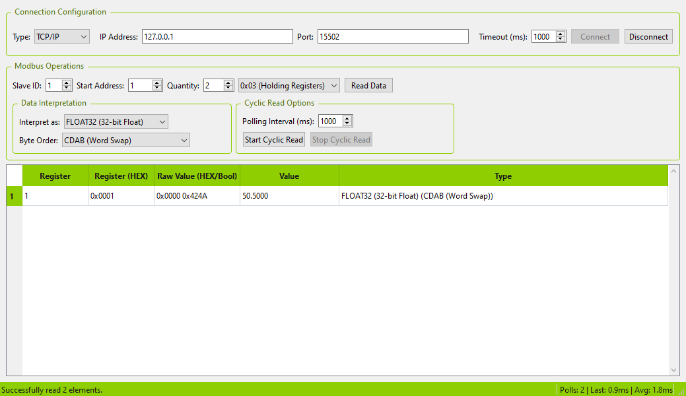
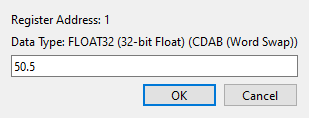

# pymms – Python Modbus Master Simulator

Prosty **Modbus master** z interfejsem graficznym (PyQt6). Służy do odczytu i zapisu rejestrów urządzeń Modbus
przez **RTU** (port COM) lub **TCP/IP**, z interpretacją danych jako liczby 16-, 32- i 64-bitowe oraz cyklicznym
odpytywaniem.

Narzędzie siostrzane: [pymss](https://github.com/exoper7/pymss) – symulator Modbus **slave**. Pozwala przetestować
pymms bez fizycznego urządzenia.


## Funkcje

- Połączenie **Modbus RTU** (port COM) lub **Modbus TCP**, z konfigurowalnym timeoutem.
- Odczyt: **0x01** Coils, **0x02** Discrete Inputs, **0x03** Holding Registers, **0x04** Input Registers.
- Interpretacja rejestrów jako UINT16, INT16, UINT32, INT32, FLOAT32, UINT64, INT64, FLOAT64,
  z kolejnością bajtów ABCD / CDAB / BADC / DCBA.
- **Zapis** wartości dwuklikiem w tabeli: 0x05 dla coili, 0x06 dla rejestrów 16-bitowych, 0x10 dla 32- i 64-bitowych.
- **Cykliczny odczyt** z ustawianym interwałem.
- **Okno logów transmisji** – każda wysłana i odebrana ramka w HEX z dekodowaniem, a także timeouty, błędy CRC,
  niepełne i spóźnione odpowiedzi.
- Statystyki na pasku statusu: liczba odpytań, liczba błędów, czas ostatniej odpowiedzi i średni czas odpowiedzi.
- Własna implementacja Modbus master (TCP i RTU) – nie wymaga biblioteki pymodbus.

## Wymagania i uruchomienie

- Python 3.10+
- Biblioteki: `PyQt6`, `pyserial`

```bash
pip install PyQt6 pyserial
```

```bash
pythonw pymms.pyw
```

Budowa pliku exe (PyInstaller, ikona jest dołączana automatycznie):

```bash
pyinstaller pymms.spec
```

## Instrukcja obsługi

### 1. Połączenie (Connection Configuration)

| Pole | Opis |
|---|---|
| **Type** | `RTU (Serial)` lub `TCP/IP` |
| **COM Port, Baud Rate, Parity, Data Bits, Stop Bits** | Parametry portu szeregowego (RTU) |
| **IP Address, Port** | Adres i port urządzenia (TCP), domyślnie `127.0.0.1:502` |
| **Timeout (ms)** | Czas oczekiwania na odpowiedź (100–30000 ms) |

Przycisk **Connect** nawiązuje połączenie, a **Disconnect** je zamyka i zeruje statystyki.

### 2. Odczyt danych (Modbus Operations)

1. Ustaw **Slave ID**, **Start Address** i **Quantity**.
2. Wybierz funkcję: `0x03 (Holding Registers)`, `0x04 (Input Registers)`, `0x01 (Coils)` lub
   `0x02 (Discrete Inputs)`.
3. Kliknij **Read Data**.

Maksymalna ilość to 125 rejestrów albo 2000 bitów. Dla typów 32-bitowych minimum to 2 rejestry, a dla
64-bitowych 4 rejestry.

### 3. Interpretacja danych (Data Interpretation)

- **Interpret as** – typ danych, na który składane są kolejne rejestry. Typy 32-bitowe zajmują 2 rejestry,
  64-bitowe 4 rejestry, a każdy wiersz tabeli pokazuje jedną wartość.
- **Byte Order** – kolejność bajtów dla typów wielorejestrowych (patrz tabela niżej).

Kolumna **Raw Value** pokazuje surowe rejestry w HEX, a kolumna **Value** wartość po interpretacji.



### 4. Zapis wartości

Kliknij dwukrotnie komórkę w kolumnie **Value**, wpisz nową wartość i zatwierdź **OK**. Zakres jest sprawdzany
dla wybranego typu. Po udanym zapisie pymms automatycznie odczytuje dane ponownie. Cykliczny odczyt jest
zatrzymywany przed zapisem.



| Dane | Funkcja zapisu |
|---|---|
| Coils (Boolean) | 0x05 Write Single Coil |
| UINT16 / INT16 | 0x06 Write Single Register |
| typy 32- i 64-bitowe | 0x10 Write Multiple Registers |

Discrete Inputs i Input Registers są w Modbus tylko do odczytu, więc urządzenie odrzuci zapis do nich.

### 5. Cykliczny odczyt (Cyclic Read Options)

Ustaw **Polling Interval (ms)** i kliknij **Start Cyclic Read**. Odczyt powtarza się z bieżącymi parametrami, aż
klikniesz **Stop Cyclic Read**. Odczyt zatrzymuje się też sam po utracie połączenia lub przekroczeniu czasu
odpowiedzi.

Pasek statusu pokazuje liczbę odpytań (**Polls**), liczbę nieudanych odpytań (**Failed**) oraz czas ostatniej
(**Last**) i średni czas odpowiedzi (**Avg**) w milisekundach.

### 6. Okno logów transmisji

Przycisk **Transmission Log** otwiera okno z pełnym zapisem komunikacji, takie samo jak w pymss.


Każda linia zawiera czas z dokładnością do milisekundy, kierunek (**TX** – zapytanie wysłane przez pymms,
**RX** – odpowiedź urządzenia), kanał (adres IP:port albo port COM), długość i pełną ramkę w HEX. Pod ramką jest
jej rozkodowanie: nagłówek MBAP (TCP) lub Slave ID (RTU), kod funkcji, adres, ilość, wartości albo wyjątek.

Na czerwono (**ERROR**) zapisywane są problemy z komunikacją:
- brak odpowiedzi w zadanym czasie (timeout), razem z bajtami niepełnej odpowiedzi, jeśli jakieś przyszły,
- błędny CRC i bajty odrzucone przed odpowiedzią lub po niej (RTU),
- spóźniona odpowiedź na poprzednie zapytanie, odrzucona przed wysłaniem kolejnego,
- odpowiedź od innego Slave ID niż odpytywany, zerwane połączenie, błąd portu szeregowego.

Opcje okna: filtry **RX / TX / Info / Errors**, **Decode frames**, **Pause**, **Auto-scroll**, limit linii
(**Max lines**), **Clear** i zapis do pliku (**Save...**).

## Kolejność bajtów

Dla wartości 32-bitowej złożonej z bajtów `A B C D` (big-endian):

| Ustawienie | Rejestry | Opis |
|---|---|---|
| ABCD (No Swap) | `AB` `CD` | standard Modbus |
| CDAB (Word Swap) | `CD` `AB` | zamienione słowa |
| BADC (Byte Swap within Words) | `BA` `DC` | zamienione bajty w słowach |
| DCBA (Full Byte Reverse) | `DC` `BA` | pełne odwrócenie |

Dla typów 64-bitowych `CDAB` zamienia połówki 32-bitowe (`W2 W3 W0 W1`).

## Testowanie z pymss

1. Uruchom [pymss](https://github.com/exoper7/pymss), wybierz `TCP/IP` z portem np. `1502`, zaimportuj
   `example_registers.csv` i kliknij **Start Server**.
2. W pymms wybierz `TCP/IP`, adres `127.0.0.1` i port `1502`, a następnie kliknij **Connect**.
3. Odczytaj `0x03 (Holding Registers)` od adresu 0. W oknie logów pymss zobaczysz każdą ramkę zapytania i odpowiedzi.
